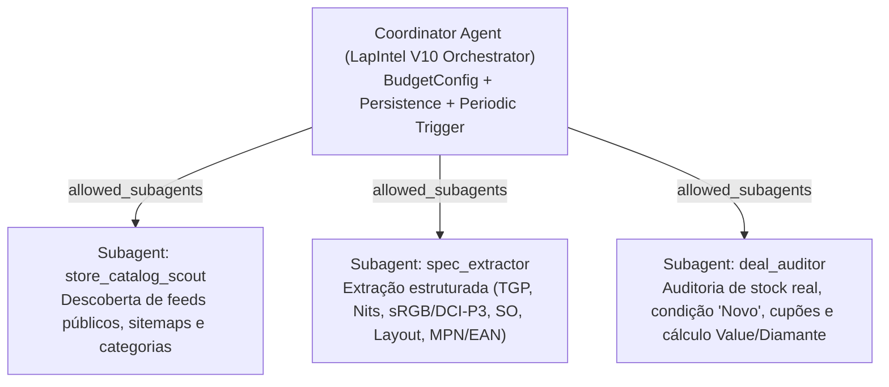

# Roadmap V10 — Autonomous Market Intelligence Engine (Google Antigravity SDK)

**Visão estratégica e arquitetura de próxima geração para o LapIntel PT.**

Enquanto a **V9 (Manutenção Silenciosa)** consolidou um pipeline determinístico, auditável e focado em portáteis com guardrails estáticos e expressões regulares, a **V10** projeta a evolução do LapIntel para um **Motor Autónomo de Inteligência de Mercado** orquestrado pelo **Google Antigravity SDK (`google-antigravity`)**.

---

## 1. Da V9 Determinística à V10 Agêntica

Na V9, a descoberta, extração de especificações (TGP, brilho SDR, gamut, SO, teclado) e validação promocional dependem de *parsers* HTML/JSON-LD e regras regex rígidas. Sempre que uma loja altera o DOM ou descreve uma campanha de desconto direto no carrinho em linguagem natural, a cobertura degrada-se ou exige manutenção manual no código.

A **V10** preserva os contratos matemáticos de avaliação (fórmula unificada do **Value**, penalização de SO `+110 €`, exclusão de teclados `ES` e usados/recondicionados, e limiar **Diamante ≥ 120**), mas substitui a camada rígida de recolha e interpretação por uma **arquitetura Multi-Agente com orçamento estritamente limitado**.

| Dimensão | LapIntel V9 (Atual) | LapIntel V10 (Google Antigravity SDK) |
|---|---|---|
| **Orquestração** | Sequencial / *ThreadPool* estático (`tracker.py`) | `Coordinator Agent` com delegação hierárquica (`SubagentConfig`) |
| **Extração Técnica** | Regex sobre HTML / tabelas de especificações | `structured_output` com schemas Pydantic validados ao nível do SKU/MPN |
| **Campanhas / Cupões** | Regras fixas por domínio | Subagente auditor capaz de interpretar condições promocionais complexas |
| **Controlo de Custos** | `MAX_HTTP_REQUESTS=420`, `MAX_PRODUCTS=300` | `BudgetConfig` nativo (`max_model_calls`, `max_tool_calls`, `max_total_tokens`) |
| **Inferência** | N/A (apenas heurísticas locais) | Híbrida: Cloud (`LocalAgentConfig`) ou Zero-Cost On-Device (`LiteRTAgentConfig` / `LocalOpenAIAgentConfig`) |
| **Estado e Memória** | JSON local (`data/price_history.json`) | Histórico JSON + sessões persistentes (`save_dir`, `conversation_id`) e compactação (`CompactionConfig`) |
| **Execução** | Cron externo (GitHub Actions 6h/6h) | GitHub Actions ou Daemon Proativo com `triggers.every` e `triggers.on_file_change` |

---

## 2. Arquitetura Multi-Agente no Google Antigravity SDK

A arquitetura V10 divide responsabilidades num grafo hierárquico de profundidade controlada (`max_subagent_depth=2`) com *allowlists* explícitas (`allowed_subagents`):



### Hierarquia e Isolamento de Subagentes (`allowed_subagents` e `max_subagent_depth`)

- **Nível 0 — `Coordinator Agent`**: gere o ciclo de vida da sessão, aplica a política de orçamento (`BudgetConfig`), agrega candidatos e emite decisões finais estruturadas (`DealDecision`).
- **Nível 1 — Subagentes Especializados (`SubagentConfig`)**:
  - `store_catalog_scout`: focado em encontrar URLs candidatos elegíveis em sitemaps e feeds autorizados sem desperdiçar chamadas em páginas esgotadas.
  - `spec_extractor`: cruza a ficha da loja com a referência exata do fabricante (MPN/EAN) para extrair TGP em Watts, brilho em nits, cobertura de cor, sistema operativo (`Windows`, `Sem SO / FreeDOS`, `Desconhecido`) e idioma do teclado sem contaminar variantes.
  - `deal_auditor`: verifica se a unidade é estritamente nova, valida a elegibilidade de campanhas de carrinho/reembolso e calcula o **Value V9/V10** determinístico através de ferramentas Python (`tools`).

---

## 3. Execução Híbrida: Cloud Gemini vs. Modelos Locais Gratuitos (On-Device)

Para garantir que o LapIntel V10 pode correr **sem custos de API** numa máquina local (com GPU ou NPU) ou no CI cloud com chaves geridas, o protótipo suporta os três motores de ligação nativos do SDK:

1. **Cloud Hosted (`LocalAgentConfig`)**:
   - Usa a Gemini API (`GEMINI_API_KEY`) para execuções rápidas no GitHub Actions.
   - Suporta também **Gemini Enterprise Agent Platform (Vertex AI)** em modo Standard (`vertex=True, project=..., location=...`) ou Express (`vertex=True, api_key=...`).
2. **On-Device Nativo Zero-Cost (`LiteRTAgentConfig`)**:
   - Executa modelos locais como **Gemma 4 26B** (`~/.litert-lm/models/gemma4-26b/model.litertlm`) diretamente em GPU (CUDA/Metal/WebGPU) ou NPU (`LiteRTBackend.GPU` / `LiteRTBackend.NPU`), sem necessidade de `GEMINI_API_KEY` nem latência de rede.
   - Aplica automaticamente o preset leve (compactação adaptada à KV-cache de 64k tokens e ferramentas essenciais) e suporta `enable_speculative_decoding=True`.
3. **Servidor Local Compatível OpenAI (`LocalOpenAIAgentConfig`)**:
   - Permite ligar o LapIntel a instâncias locais **Ollama** (`http://localhost:11434/v1`) ou **LM Studio** (`http://localhost:1234/v1`) invocando `.lightweight()`.

---

## 4. Extração Estruturada (`structured_output`) e Guardrails de Domínio

Em vez de depender exclusivamente de expressões regulares frágeis quando uma loja escreve *"Placa gráfica dedicada até 115W com Dynamic Boost, ecrã 100% sRGB de 300 cd/m² — Oferta sem Sistema Operativo"*, o agente utiliza `response_schema` com modelos **Pydantic**:

- **`LaptopSpecExtraction`**:
  - Identificadores verificados (`sku`, `mpn`, `ean`, `brand`, `model_name`).
  - Especificações críticas tipadas (`gpu_model`, `gpu_tgp_watts`, `display_nits`, `color_gamut_srgb_pct`, `panel_type`, `ram_gb`, `storage_gb`, `battery_wh`, `weight_kg`).
  - Tri-state de Sistema Operativo (`os_status`: `"included"`, `"none_or_freedos"`, `"unknown"`), garantindo que `"none_or_freedos"` soma automaticamente **+110 €** ao custo efetivo e `"unknown"` nunca assume custo zero confirmado.
  - Idioma do teclado (`keyboard_layout`) e condição do artigo (`is_new_condition`, `in_stock_confirmed`).
- **`DealDecision`**:
  - Resultado auditado com `effective_price_eur`, `value_score`, `tier` (`Diamante`, `Ouro`, `Prata`, `Bronze`, `Sem Tier`), `should_notify_ntfy` (apenas `True` se **Diamante ≥ 120**, em stock e condição nova) e justificação técnica concisa.

---

## 5. Controlo Estrito de Custos e Chamadas (`BudgetConfig`)

Inspirado diretamente nos orçamentos de execução da V8/V9 (`MAX_HTTP_REQUESTS`, `MAX_DETAIL_FETCHES`, `MAX_RUNTIME_SECONDS`), o LapIntel V10 impõe limites preventivos por sessão através de `types.BudgetConfig`:

```python
budget_config = types.BudgetConfig(
    max_model_calls=15,
    max_tool_calls=30,
    max_input_tokens=80_000,
    max_output_tokens=15_000,
    max_total_tokens=95_000,
)
```

No final de cada turno, o orquestrador inspeciona `response.stop_reason` (`StopReason.MAX_MODEL_CALLS_EXCEEDED`, `StopReason.MAX_TOOL_CALLS_EXCEEDED`, `StopReason.MAX_TOTAL_TOKENS_EXCEEDED`) para registar telemetria limpa e terminar graciosamente sem custos inesperados.

---

## 6. Execução Proativa (`triggers`) e Memória Persistente (`persistence`)

- **Triggers Proativos (`google.antigravity.triggers`)**:
  - `every(21600, periodic_market_scan)`: substitui ou complementa o cron externo executando varrimentos autónomos a cada 6 horas.
  - `on_file_change("config/", reload_policy_trigger)`: reage instantaneamente a alterações nos ficheiros de política ou catálogos locais.
- **Memória Persistente (`save_dir` e `conversation_id`)**:
  - Ao persistir a sessão em `data/agent_sessions/` (`save_dir`) e reutilizar o `conversation_id` com `CompactionConfig(token_threshold=50_000)`, o agente recorda anomalias de lojas, falsos descontos recorrentes e SKUs já descartados em runs anteriores sem estourar a janela de contexto.

---

## 7. Expansão Futura: Multi-Categoria e Dashboard Estático

1. **Suporte Multi-Categoria Modular**:
   - A separação entre `SpecExtraction` (Pydantic) e `calculate_unified_value` (Tool) permite adicionar perfis dedicados para:
     - **Monitores** (OLED/Mini-LED, taxa de atualização, delta-E, USB-C PD);
     - **GPUs Desktop** (VRAM, largura de banda, comprimento físico, rácio €/frame);
     - **Tablets & Ultrabooks Universitários** (autonomia real, suporte para stylus, peso sub-1.2 kg).
2. **Dashboard Estático Leve (GitHub Pages)**:
   - Exportação opcional de um artefacto estático (`docs/dashboard/latest_deals.json`) gerado pelo agente a partir do histórico de 30/60/90 dias, permitindo visualizar a evolução de preços e a decomposição do Value sem necessitar de backend dedicado.

---

## 8. Protótipo Executável (`scripts/v10_agent_prototype.py`)

O ficheiro [`scripts/v10_agent_prototype.py`](../scripts/v10_agent_prototype.py) implementa esta arquitetura e pode ser testado em modo demonstrativo seguro (`--dry-run`, sem chaves nem dependências externas) ou com o SDK ativo:

```bash
# Modo demonstrativo offline (compatível com o ambiente CI da V9)
python scripts/v10_agent_prototype.py --dry-run

# Execução com Gemini Cloud (requer google-antigravity e GEMINI_API_KEY)
python scripts/v10_agent_prototype.py --prompt "Analisa o Lenovo Legion Slim 5 16AHP9 (83DH003KPG) a 1299€ sem SO em stock"

# Execução 100% local e gratuita via LiteRT (Gemma 4 26B on-device)
python scripts/v10_agent_prototype.py --local --model-path ~/.litert-lm/models/gemma4-26b/model.litertlm
```
